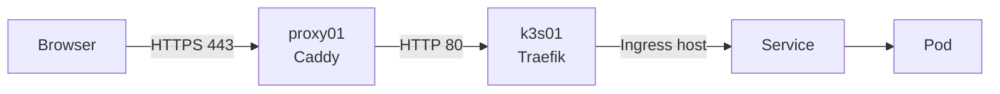

# Deploying Services on k3s

`k3s01` runs a single-node Kubernetes cluster (k3s), installed by the `k3s` Ansible role ([`ansible/k3s.yml`](../../ansible/k3s.yml)). This guide explains how to run a service on it and publish it over HTTPS through `proxy01`.

Every service in the [network log](../10-network-log.md) already has its own VM. Run a service on k3s only if it isn't planned on a VM, or after agreeing with the owner of that service.

## The cluster

| Item          | Value                                                                                  |
| ------------- | -------------------------------------------------------------------------------------- |
| Node          | `k3s01` (VM 2031), `10.10.20.31`, 4 vCPU, 8 GB RAM, 64 GB disk                          |
| Version       | k3s `v1.36.5+k3s1` (`k3s_version` in the role defaults)                                 |
| API           | `https://10.10.20.31:6443`                                                             |
| kubectl       | `/usr/local/bin/kubectl` and `/root/.kube/config` on `ctrl-iac`                         |
| Ingress       | Traefik, IngressClass `traefik` (default), listening on `10.10.20.31:80` and `:443`     |
| Storage       | StorageClass `local-path` (default), volumes stored on `k3s01` in `/var/lib/rancher/k3s/storage` |
| Load balancer | ServiceLB, which opens `LoadBalancer` ports on `10.10.20.31`                           |
| Helm          | Built-in Helm controller (`HelmChart` resources), no `helm` CLI needed                 |

## How a request reaches a service



Caddy on `proxy01` handles TLS and forwards the request to Traefik on port 80, keeping the original `Host` header. Traefik picks the Ingress whose `host` matches it and sends the request to that Ingress's Service. Every service on k3s therefore shares the same upstream, and only the hostname tells them apart.

Firewall rule 8 allows only `proxy01` to reach port 80 on `k3s01` (see section 10.2 of the network log). Ingresses don't need TLS: Caddy already handles it.

## Getting a shell with kubectl

kubectl is set up on `ctrl-iac`, which you reach through the Proxmox host:

```bash
ssh root@10.85.2.127          # pve
pct exec 110 -- bash -l       # root shell on ctrl-iac
kubectl get nodes
```

The kubeconfig holds the cluster admin key. Never copy it into the repository or paste it anywhere.

## Workflow

The workflow is the same as for Terraform: edit the manifests on your own computer, push them, then pull and apply them from `ctrl-iac`. Keep one file per service in `k8s/` at the root of the repository, for example `k8s/whoami.yaml`.

```bash
cd /root/entertainment-center-infra && git pull
kubectl apply -f k8s/<service>.yaml
```

`kubectl apply` is idempotent: running it again applies only what changed in the file.

## Deploying a service

This example deploys [`traefik/whoami`](https://hub.docker.com/r/traefik/whoami), a tiny web server that echoes the request back. It's a good way to check the whole path before deploying a real application.

### 1. Write the manifest

`k8s/whoami.yaml`:

```yaml
apiVersion: v1
kind: Namespace
metadata:
  name: whoami
---
apiVersion: apps/v1
kind: Deployment
metadata:
  name: whoami
  namespace: whoami
spec:
  replicas: 1
  selector:
    matchLabels:
      app: whoami
  template:
    metadata:
      labels:
        app: whoami
    spec:
      containers:
        - name: whoami
          image: traefik/whoami:v1.12.0
          ports:
            - containerPort: 80
---
apiVersion: v1
kind: Service
metadata:
  name: whoami
  namespace: whoami
spec:
  selector:
    app: whoami
  ports:
    - port: 80
      targetPort: 80
---
apiVersion: networking.k8s.io/v1
kind: Ingress
metadata:
  name: whoami
  namespace: whoami
spec:
  ingressClassName: traefik
  rules:
    - host: whoami.example          # the hostname proxy01 serves
      http:
        paths:
          - path: /
            pathType: Prefix
            backend:
              service:
                name: whoami
                port:
                  number: 80
```

| Object     | Role                                                                                 |
| ---------- | ------------------------------------------------------------------------------------ |
| Namespace  | Groups everything that belongs to the service. Deleting it deletes all of it.       |
| Deployment | Runs the container and restarts it if it fails.                                      |
| Service    | Gives the pods a stable address inside the cluster. Its `selector` must match the pod labels. |
| Ingress    | Tells Traefik which hostname goes to the Service.                                    |

Pin image versions (`v1.12.0`, not `latest`) so a restart never pulls a different version than the one you tested.

### 2. Apply it

On `ctrl-iac`:

```bash
kubectl apply -f k8s/whoami.yaml
kubectl -n whoami get pods,svc,ingress
```

Wait until the pod is `Running` and `1/1` ready.

### 3. Test it directly

`ctrl-iac` is on the same subnet as `k3s01`, so you can test Traefik without going through `proxy01`:

```bash
curl -H 'Host: whoami.example' http://10.10.20.31/
```

whoami answers with the request it received. A `404 page not found` means that Traefik found no route for that hostname (see [Troubleshooting](#troubleshooting)).

### 4. Publish it through proxy01

Ask the owner of `proxy01` to add a site block to the Caddy configuration:

```caddy
whoami.<domain> {
    reverse_proxy 10.10.20.31:80
}
```

Caddy passes the `Host` header through by default, so the Ingress `host` must be exactly the name of the Caddy site. The name must also resolve to `proxy01` in the internal DNS.

## Keeping data

A container's file system is erased whenever the pod is recreated. To keep data, request a volume with a PersistentVolumeClaim (PVC) and mount it in the container:

```yaml
apiVersion: v1
kind: PersistentVolumeClaim
metadata:
  name: data
  namespace: myapp
spec:
  accessModes:
    - ReadWriteOnce
  resources:
    requests:
      storage: 5Gi
---
apiVersion: apps/v1
kind: Deployment
metadata:
  name: myapp
  namespace: myapp
spec:
  replicas: 1
  strategy:
    type: Recreate                  # never run two copies on the same data
  selector:
    matchLabels:
      app: myapp
  template:
    metadata:
      labels:
        app: myapp
    spec:
      containers:
        - name: myapp
          image: <image>:<version>
          volumeMounts:
            - name: data
              mountPath: /data
      volumes:
        - name: data
          persistentVolumeClaim:
            claimName: data
```

- The volume is a folder on the disk of `k3s01`. It isn't replicated, so it is only as safe as the backups of VM 2031.
- The `local-path` reclaim policy is `Delete`: deleting the PVC, or the namespace that contains it, permanently deletes the data.
- The PVC stays `Pending` until a pod uses it. This is normal.

## Passwords and other secrets

Never commit a password to the repository. Create the Secret directly in the cluster from `ctrl-iac`, without leaving the value in the shell history:

```bash
read -rs DB_PASSWORD
kubectl -n myapp create secret generic myapp-db --from-literal=password="$DB_PASSWORD"
unset DB_PASSWORD
```

Then read it from the manifest:

```yaml
          env:
            - name: DB_PASSWORD
              valueFrom:
                secretKeyRef:
                  name: myapp-db
                  key: password
```

The Secret exists only in the cluster. Mention its name in a comment in the manifest so the next person knows to create it.

## Installing a Helm chart

Many applications are distributed as Helm charts. k3s installs them itself from a `HelmChart` resource, which goes in `k8s/` like any other manifest:

```yaml
apiVersion: helm.cattle.io/v1
kind: HelmChart
metadata:
  name: <app>
  namespace: kube-system
spec:
  repo: <chart repository URL>
  chart: <chart name>
  version: <chart version>
  targetNamespace: <app>
  createNamespace: true
  valuesContent: |-
    # the chart's values, as in a values.yaml file
```

- k3s runs the installation in a `helm-install-<app>` job. Follow it with `kubectl -n kube-system logs -f job/helm-install-<app>`.
- Changing `valuesContent` or `version` and applying the file again upgrades the release.
- Deleting the `HelmChart` uninstalls the release.

Most charts have an `ingress` section in their values. Set its class to `traefik` and its host to the name served by `proxy01`.

## Services that don't use HTTP

An Ingress only carries HTTP. For another protocol, use a Service of type `LoadBalancer`: ServiceLB then opens the port on `10.10.20.31`.

```yaml
apiVersion: v1
kind: Service
metadata:
  name: myapp
  namespace: myapp
spec:
  type: LoadBalancer
  selector:
    app: myapp
  ports:
    - port: 5000
      targetPort: 5000
      protocol: TCP
```

Ports 80, 443 and 6443 are already used. A new port also needs a firewall rule, and it must be added to the [network log](../10-network-log.md) in the same commit.

## Updating and removing a service

| Task                     | Command                                                         |
| ------------------------ | --------------------------------------------------------------- |
| Change the configuration | Edit the file, push, pull, then `kubectl apply -f k8s/<service>.yaml` |
| Upgrade the application  | Change the image tag, then apply the file again                 |
| Restart the pods         | `kubectl -n <namespace> rollout restart deployment/<name>`       |
| Remove the service       | `kubectl delete -f k8s/<service>.yaml` (this also deletes its volumes) |

## Troubleshooting

Start with `kubectl -n <namespace> get pods` and `kubectl -n <namespace> describe pod <pod>`: the events at the bottom of `describe` usually give the cause.

| Symptom                                   | Likely cause and check                                                                 |
| ----------------------------------------- | -------------------------------------------------------------------------------------- |
| Pod stays `Pending`                       | Its PVC can't be created, or the node is out of CPU or memory. Read the events.        |
| `ErrImagePull` or `ImagePullBackOff`      | Wrong image name or tag, or `k3s01` can't reach the registry on the Internet.          |
| `CrashLoopBackOff`                        | The application itself fails. Read `kubectl -n <namespace> logs <pod> --previous`.     |
| `curl` returns `404 page not found`       | No Ingress matches the `Host` header, or the Service has no ready pod. Check `kubectl get ingress -A` and `kubectl -n <namespace> get endpointslices`. |
| `curl` returns `502 Bad Gateway`          | The Service's `targetPort` doesn't match the port the container listens on.            |
| Works with `curl`, not through `proxy01`  | Check the Caddy site block, the DNS record and firewall rule 8.                         |
