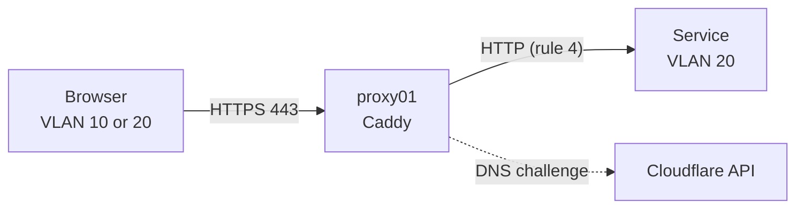

# Publishing Services with Caddy

`proxy01` runs Caddy, the reverse proxy that publishes the web interface of every internal service over HTTPS, as `<name>.divertissementestrie.ca`. The `caddy` Ansible role ([`ansible/caddy.yml`](../../ansible/caddy.yml)) installs and configures it.

## How it works

| Item          | Value                                                                                       |
| ------------- | ------------------------------------------------------------------------------------------- |
| Host          | `proxy01` (VM 8010), `10.10.80.10`, VLAN 80 (DMZ)                                             |
| Domain        | `divertissementestrie.ca`, DNS hosted by Cloudflare                                          |
| Certificates  | Let's Encrypt, DNS challenge through the Cloudflare API: no inbound port is needed            |
| Binary        | Caddy with the `caddy-dns/cloudflare` module, built by caddyserver.com                       |
| Configuration | `/etc/caddy/Caddyfile`, generated from `caddy_sites` in [`ansible/inventory/host_vars/proxy01.yml`](../../ansible/inventory/host_vars/proxy01.yml) |
| API token     | `/etc/caddy/caddy.env` on `proxy01` (root:caddy, mode 640), never in the repository          |



The firewall lets VLANs 10 and 20 reach `proxy01` on 443, and lets only `proxy01` reach the services' HTTP ports (rule 4, aliases `SERVICES_HTTP` and `PORTS_HTTP`). See section 10.3 of the [network log](../10-network-log.md).

## First setup

1. **Create a Cloudflare API token**: Cloudflare dashboard → *My Profile → API Tokens → Create Token* → template *Edit zone DNS*, zone `divertissementestrie.ca` only.
2. **Store it on `ctrl-iac`**, next to the Proxmox token, so it never lands in the repository or the shell history:

   ```bash
   install -m 600 /dev/null /root/.cloudflare.env
   read -rs TOKEN && echo "export CLOUDFLARE_API_TOKEN=$TOKEN" > /root/.cloudflare.env && unset TOKEN
   ```

3. **Run the playbook**:

   ```bash
   cd /root/entertainment-center-infra/ansible
   . /root/.cloudflare.env && ansible-playbook caddy.yml
   ```

The token is copied to `proxy01` on the first run. Later runs don't need it: without `CLOUDFLARE_API_TOKEN`, the role keeps the token already in place. Export it again only to replace it.

## Publishing a service

1. Add the service to `caddy_sites` in [`ansible/inventory/host_vars/proxy01.yml`](../../ansible/inventory/host_vars/proxy01.yml):

   ```yaml
   caddy_sites:
     - nom: netdata
       upstream: 10.10.20.22:19999
   ```

   Services on k3s all use the Traefik ingress as upstream (`10.10.20.31:80`); see [deploying services on k3s](deploying-services-on-k3s.md).

   Optional keys:

   | Key       | Use                                                                                                          |
   | --------- | ------------------------------------------------------------------------------------------------------------ |
   | `reseaux` | Only these networks may open the site; Caddy answers 403 to the others                                       |
   | `ca`      | The upstream uses HTTPS with a private or self-signed certificate: path of the public certificate that vouches for it, relative to `ansible/` (for example `files/ca/proxmox.pem`). Caddy verifies the upstream with it. |
   | `nom_tls` | Name to verify in that certificate, when it doesn't contain the upstream's address |

2. Check that the firewall allows `proxy01` to reach the upstream: its address must be in `SERVICES_HTTP` and its port in `PORTS_HTTP` on fw01, or a dedicated DMZ rule allows it (`SERVICES_HTTPS` lists the upstreams reached on 443). Add them if needed and record the change in the network log.
3. Make the name resolve to `proxy01` inside the centre, on both DNS servers:
   - **fw01** (VLAN 10, the Linux hosts): pfSense → *Services → DNS Resolver → Host Overrides*, host `netdata`, domain `divertissementestrie.ca`, IP `10.10.80.10`.
   - **dc01** (the Windows workstations of VLAN 20): a primary zone named after the full name, holding only an A record at its root, so the rest of the public domain still resolves normally:

     ```powershell
     Add-DnsServerPrimaryZone -Name netdata.divertissementestrie.ca -ReplicationScope Domain
     Add-DnsServerResourceRecordA -ZoneName netdata.divertissementestrie.ca -Name '@' -IPv4Address 10.10.80.10
     ```

4. Push, then on `ctrl-iac`: `git pull && ansible-playbook caddy.yml`. Caddy reloads and gets the certificate within about a minute.

The DMZ only lets web traffic out, so Caddy can't query Cloudflare's name servers on port 53 to check that the challenge record has propagated. Each site therefore skips that check and waits 30 seconds instead (`propagation_delay`); Let's Encrypt checks the record on its side.

## Published sites

Every site is open to VLANs 10 and 20 only.

| Address                                  | Service       | Upstream                                 | Firewall (DMZ)                                  |
| ---------------------------------------- | ------------- | ---------------------------------------- | ----------------------------------------------- |
| `https://proxmox.divertissementestrie.ca`    | Proxmox       | `https://10.85.2.127:8006`               | Rule "Caddy vers l interface web de Proxmox"    |
| `https://pfsense.divertissementestrie.ca`    | pfSense       | `https://10.10.20.1`                     | `SERVICES_HTTPS`                                |
| `https://freepbx.divertissementestrie.ca`    | FreePBX       | `https://10.10.20.20`                    | `SERVICES_HTTPS`                                |
| `https://veeam.divertissementestrie.ca`      | Veeam         | `https://10.10.20.13`                    | `SERVICES_HTTPS`                                |
| `https://osticket.divertissementestrie.ca`   | osTicket      | `10.10.20.12:80`                         | Rule 4                                          |
| `https://homarr.divertissementestrie.ca`     | Homarr        | `10.10.20.41:7575`                       | Rule 4                                          |
| `https://www.divertissementestrie.ca`        | Website       | `10.10.20.31:80` (Traefik)               | Rule 4                                          |
| `https://phpmyadmin.divertissementestrie.ca` | phpMyAdmin    | `10.10.20.31:80` (Traefik)               | Rule 4                                          |

The public certificates of the HTTPS upstreams are in [`ansible/files/ca/`](../../ansible/files/ca/). If a service replaces its certificate, copy the new one there and run the playbook, or Caddy answers `502`. pfSense's expires in April 2027.

pfSense refuses a name it doesn't know: its public name is in *System → Advanced → Admin Access → Alternate Hostnames*.

## Checking

```bash
ssh -i ~/.ssh/ansible_cde ansible@10.10.80.10
systemctl status caddy
journalctl -u caddy -n 50        # certificate requests and errors
caddy list-modules | grep cloudflare
```

## Troubleshooting

| Symptom                                  | Check                                                                                       |
| ---------------------------------------- | ------------------------------------------------------------------------------------------- |
| The playbook stops at "Verifier le jeton" | First run without `CLOUDFLARE_API_TOKEN`: load `/root/.cloudflare.env` first.               |
| No certificate, `journalctl` shows a Cloudflare error | The token's permissions (Zone.DNS:Edit on the right zone) or its value.        |
| The name doesn't resolve                 | The host override on pfSense (fw01 clients) or the zone on dc01 (Windows clients).           |
| `403`                                    | The client's network isn't in the site's `reseaux`.                                         |
| `502 Bad Gateway`                        | The service isn't running, the firewall blocks `proxy01` → upstream, or the upstream's certificate no longer matches the copy in `ansible/files/ca/`. |
| Unreachable from home                    | Public access isn't set up: fw01's WAN TCP 443 already goes to the Xray VPN. Connect through the VPN. |

## Updating Caddy

The role only downloads Caddy when the Cloudflare module is missing. To move to the latest version, delete the binary and run the playbook again:

```bash
ssh -i ~/.ssh/ansible_cde ansible@10.10.80.10 sudo rm /usr/bin/caddy
ansible-playbook caddy.yml
```
